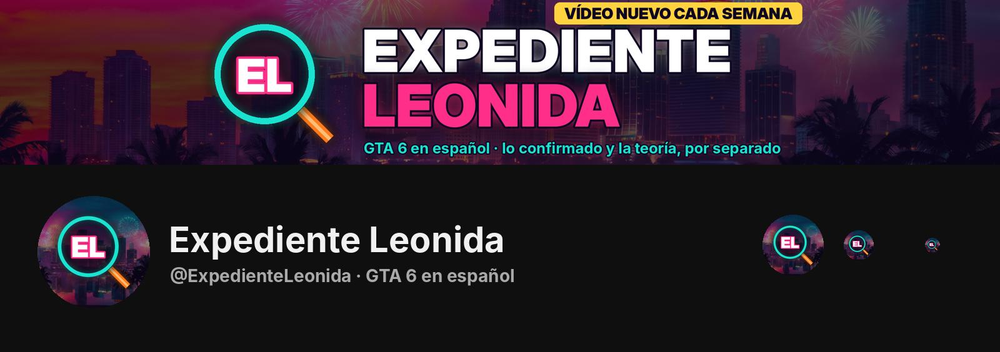

# Kit del canal · Expediente Leonida

Todo listo para copiar y subir en **YouTube Studio → Personalización**. Las imágenes se regeneran con `python3 herramientas/canal_arte.py`.



## 1 · Nombre e identificador
| Campo | Valor |
|---|---|
| **Nombre del canal** | **Expediente Leonida** |
| **Identificador** | `@ExpedienteLeonida` (alternativas si está cogido: `@ExpedienteLeonidaES`, `@ExpLeonida`) |
| **Lema** | *Lo confirmado, por un lado; la teoría, por otro.* |

**Por qué este nombre:** suena a investigación y rigor (cada vídeo es un «expediente») y Leonida es el estado donde transcurre GTA 6, así que conecta con el juego sin usar «GTA» ni «Rockstar». Esas dos son marcas registradas y meterlas en el nombre del canal puede acabar en una reclamación. Además, permite series como «Expediente: atracos» o «Expediente: secretos».

Otras opciones que se descartaron: Neón Leonida (suena a estética, no a información), Señal Vice (demasiado genérico), Archivo Vice City (se confunde con el juego de 2002) y Ruta Leonida (encaja peor con los análisis).

## 2 · Imágenes
| Archivo | Dónde va | Notas |
|---|---|---|
| `avatar_800x800.png` | Foto de perfil | Lupa de neón turquesa con el monograma **EL**, sobre el skyline nocturno. Se reconoce a 98, 48 y 24 px (ver la vista previa) |
| `banner_2560x1440.jpg` | Imagen del banner | 572 KB (el límite es 6 MB). El texto va dentro de la zona segura de 1546x423, que se ve en móvil, TV y escritorio |
| `banner_guia_zona_segura.jpg` | Solo para revisar | Verde: zona segura. Amarillo: lo que se ve en escritorio |
| `marca_agua_150x150.png` | Marca de agua del vídeo | Fondo transparente. Ponla en «Mostrar al final del vídeo» o «Durante todo el vídeo» |

**Identidad:** magenta `#FF2E88`, turquesa `#19E3D0`, naranja `#FF7A1A`, amarillo `#FFD23F` y fondo índigo `#0E0622`. Tipografía Inter Display Black / Inter Bold (licencia libre SIL OFL). El fondo es una ilustración original generada con Nano Banana: nada de capturas, logos ni tipografías oficiales del juego.

## 3 · Descripción del canal («Acerca de»)
```
Expediente Leonida analiza GTA 6 en español con una regla: lo confirmado, por un lado; la teoría, por otro, y dicha en voz alta.

Aquí encontrarás análisis del mapa de Leonida, sus personajes, los tráileres, las mecánicas, los vehículos y los atracos. Y, desde el lanzamiento, guías prácticas, secretos de la comunidad y expectativas contra realidad.

Sin clickbait, sin filtraciones y sin inventar.
🗓️ Vídeo nuevo cada semana.
✉️ Contacto profesional: [tu email]

Canal no afiliado a Rockstar Games ni a Take-Two Interactive. Las imágenes son ilustraciones originales: no usamos capturas ni material oficial del juego.
```

## 4 · Palabras clave del canal
(Studio → Configuración → Canal → Palabras clave)
```
GTA 6, GTA VI, Grand Theft Auto 6, Leonida, Vice City, Jason y Lucia, GTA 6 español, GTA 6 noticias, GTA 6 análisis, GTA 6 mapa, GTA 6 tráiler, GTA 6 guía, GTA 6 Online, Expediente Leonida
```

## 5 · Enlaces y ajustes
- **Enlaces del banner:** 1) Lista «Todos los expedientes», 2) Vídeo 09 «Antes de jugar», 3) tu red social principal si tienes.
- **Idioma del canal:** español. **País:** España.
- **Vídeo de bienvenida para quien no está suscrito:** el 09 («Antes de jugar», el más práctico). Como vídeo destacado para suscriptores, el último publicado.
- **Secciones de la página principal:** 1) Último vídeo, 2) Lista «Guías prácticas» (09, 08), 3) Lista «Análisis de Leonida» (01–07), 4) Lista «GTA 6 Online» (10).
- **Valores predeterminados de subida:** categoría «Videojuegos», idioma «Español (España)», licencia estándar y la casilla «contenido alterado o sintético» marcada (las ilustraciones y la voz son de IA).

## 6 · Pasos para montarlo (unos 10 minutos)
1. Crea el canal en youtube.com → Crear un canal → nombre **Expediente Leonida**.
2. Studio → Personalización → **Perfil**: sube `avatar_800x800.png`, define el identificador y pega la descripción.
3. **Imagen del banner**: sube `banner_2560x1440.jpg` y comprueba en la previsualización que el texto se ve entero en móvil y en TV.
4. **Marca de agua**: sube `marca_agua_150x150.png`.
5. Configuración → Canal: palabras clave y país. Configuración → **Valores predeterminados de subida**: lo del punto 5.
6. Crea las listas y las secciones de la página principal.
